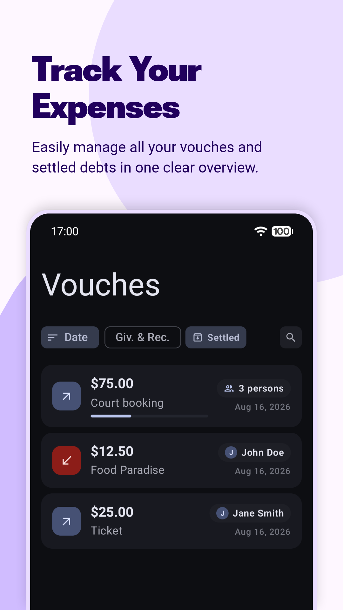
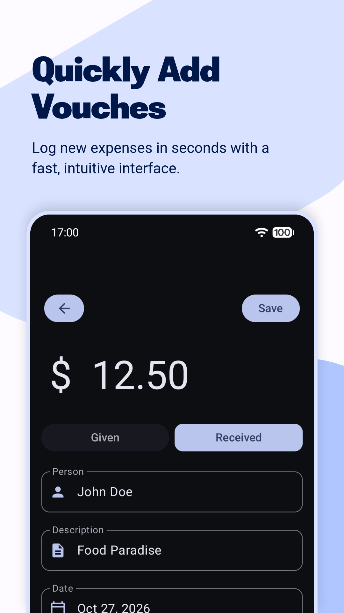
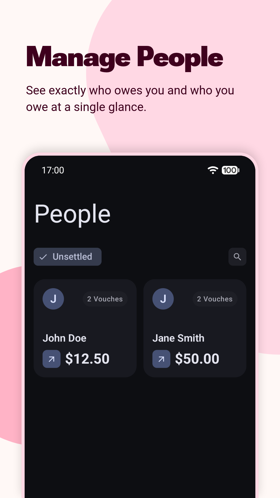
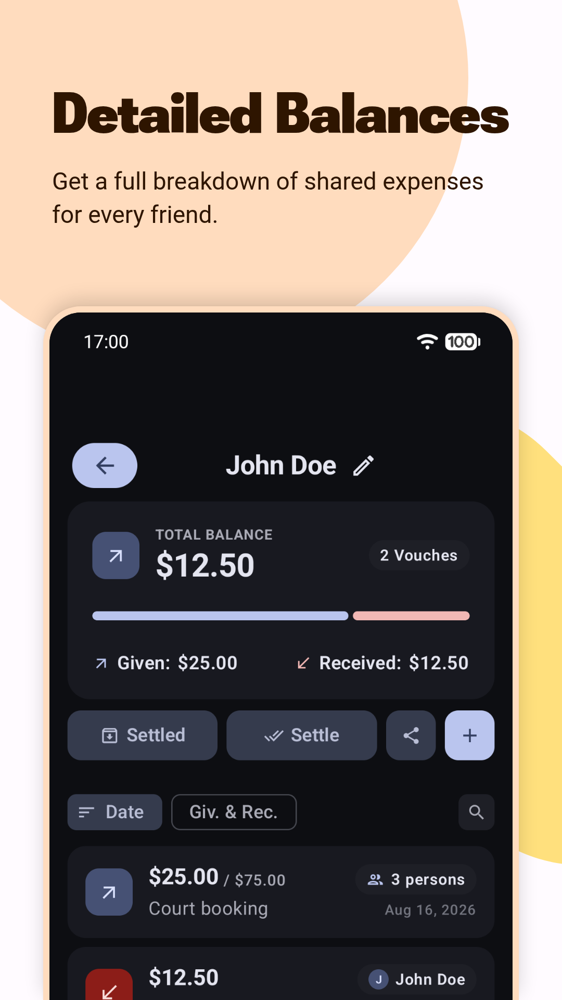
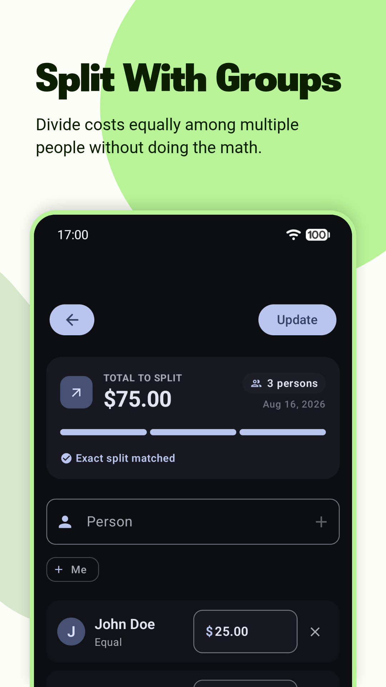
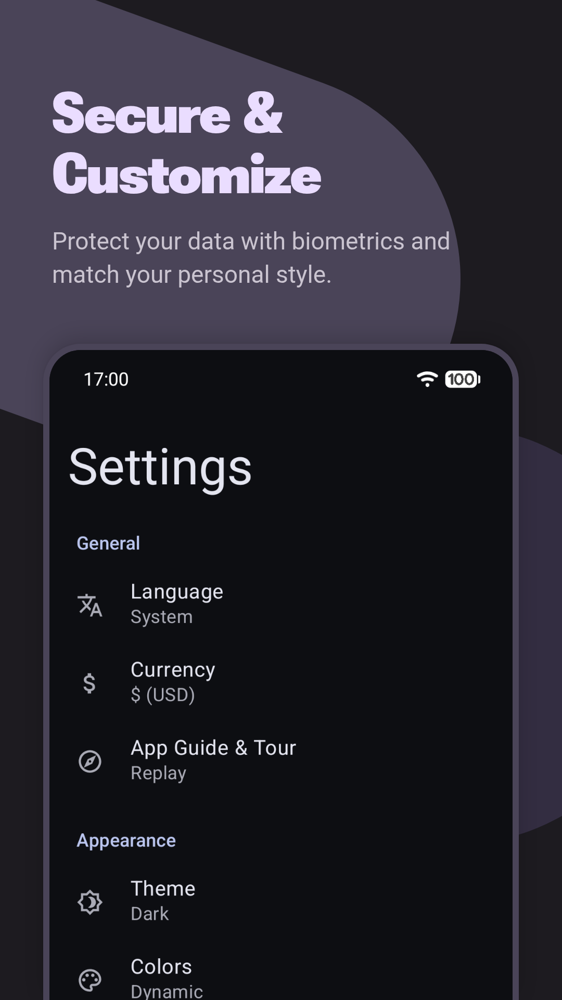

# iyox Vouch

iyox Vouch is a personal debt and IOU tracking application presented in [Material You Expressive](https://m3.material.io/) style.

---

## Screenshots

  
  
  
  
  
  

## Features

- **Debt & IOU Tracking**: Easily track money borrowed or lent with amounts, dates, and descriptions.
- **Group Vouches**: Split expenses and bills across multiple people effortlessly.
- **People Overview**: View individual balances, net debts/credits, and settle balances with one tap.
- **Material You Expressive**: Clean, modern interface with dynamic colors and dark theme support.
- **Multi-Currency & Multilingual**: Customizable currency selection and multilingual support (English, German).
- **Data Backup & Restore**: Export and import your data in a JSON format for safe keeping and easy migration.

## Libraries Used

- [Jetpack Compose](https://developer.android.com/jetpack/compose) (Apache-2.0) - Modern toolkit for building native Android UI
- [Material 3](https://developer.android.com/jetpack/androidx/releases/compose-material3) (Apache-2.0) - Material You UI components for Compose
- [Room](https://developer.android.com/jetpack/androidx/releases/room) (Apache-2.0) - SQLite object mapping and persistence library
- [Navigation Compose](https://developer.android.com/jetpack/androidx/releases/navigation) (Apache-2.0) - Navigation component for Jetpack Compose
- [Lifecycle & ViewModel](https://developer.android.com/jetpack/androidx/releases/lifecycle) (Apache-2.0) - Lifecycle management and state handling
- [Biometric](https://developer.android.com/jetpack/androidx/releases/biometric) (Apache-2.0) - Biometric authentication prompt
- [Gson](https://github.com/google/gson) (Apache-2.0) - JSON serialization and deserialization library
- [Core SplashScreen](https://developer.android.com/jetpack/androidx/releases/core) (Apache-2.0) - Splash screen compatibility library

## Contributing

Contributions are always welcome.

- **Reporting Issues**: If you find a bug or have an idea, please open an issue on GitHub.
- **Contributing Code**: Please see the [Contributing Guidelines](CONTRIBUTING.md) for details on project setup, running tests (local and instrumented), code style, and submitting pull requests.
- **Translating**: I'm really grateful for each new language added. See the [Translating section](CONTRIBUTING.md#translating) in CONTRIBUTING.md.

## License

iyox Vouch is licensed under the **[GNU General Public License v3.0](LICENSE)**.
